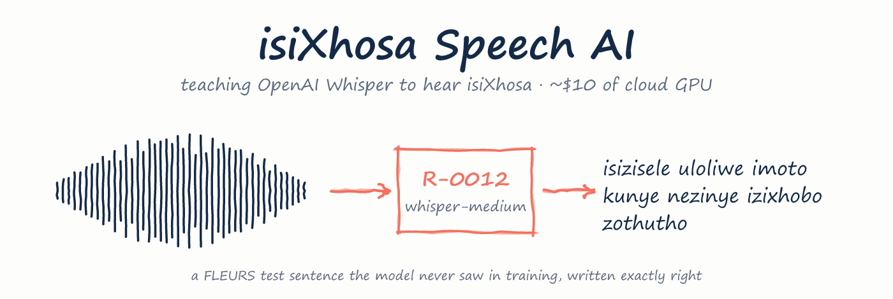
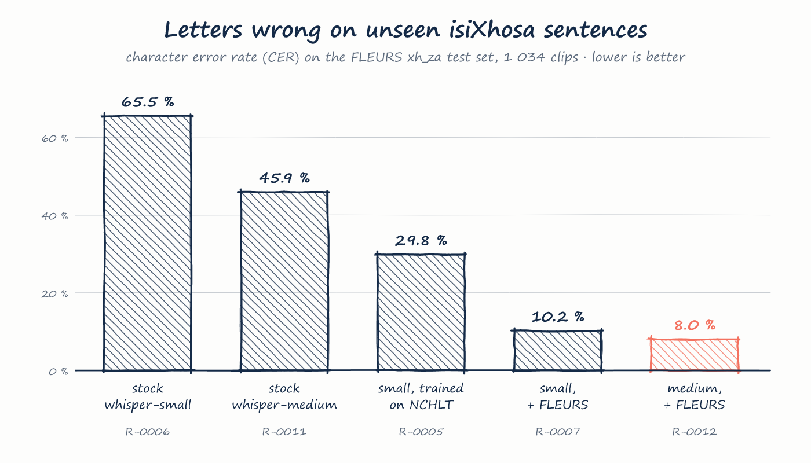
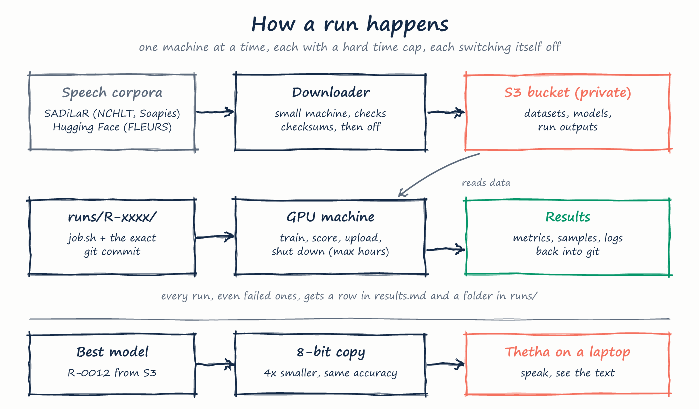

<p align="center">
  
</p>

<p align="center">
  
  
  
  
  
  <br>
  <a href="https://ntlakanipho-thetha.static.hf.space/index.html"></a>
  <a href="https://huggingface.co/Ntlakanipho/whisper-medium-isixhosa"></a>
</p>

OpenAI's Whisper speaks almost a hundred languages, but **isiXhosa isn't one of them**. Ask stock Whisper to transcribe
isiXhosa and it guesses Swahili, Yoruba or Shona, or switches to a different alphabet altogether. This project fine-tunes Whisper
until it writes isiXhosa properly, one carefully logged experiment at a time, on rented cloud GPUs, for about the price
of a takeaway meal.

It is a learning project by **Ntlakanipho Mgaguli** (Computer Engineering, CPUT). The goal was to understand speech AI
end to end, from raw corpora to a model you can talk to, not just to ship a checkpoint.

> [!TIP]
> **Try it:** speak isiXhosa into **[Thetha](https://ntlakanipho-thetha.static.hf.space/index.html)** on your phone or computer. The small model runs inside your
> browser (about 300 MB, downloaded once), so nothing you record leaves your device.
>
> **Use it:** [whisper-medium-isixhosa](https://huggingface.co/Ntlakanipho/whisper-medium-isixhosa) (more accurate) or [whisper-small-isixhosa](https://huggingface.co/Ntlakanipho/whisper-small-isixhosa) (faster) on Hugging Face.

> [!NOTE]
> **Training paused on 19 October 2026** ([D-0018](decisions.md)). Stages 1–3 are complete, and the best model is
> **R-0012**. Stage 4 (isiXhosa mixed with English) was measured and its training prepared, but never run.

## Hear the difference

The same FLEURS test sentences, which none of the models saw in training:

| | What each model wrote |
|---|---|
| **Said** | **isizisele uloliwe imoto kunye nezinye izixhobo zothutho** |
| Stock whisper-medium | isisi zisele ulo liwe imo toku nye nizi nyezi kwa wazututu |
| R-0012 (this project) | isizisele uloliwe imoto kunye nezinye izixhobo zothutho ✓ |
| **Said** | **kwimozulu eshushu yase middle east indlu yayingabalulekanga** |
| Stock whisper-medium | kuimuzul esho shiasi mtili isti msu yai inga baluleka |
| R-0012 (this project) | kwimozulu eshushu yase middle east indlu yayingabalulekanga ✓ |
| **Said** | **esi sibini sinokukhetha ukwenza isicwangciso sokwamkelwa komntwana waso** |
| Stock whisper-small | sisi bini suyo kiki kwa kwa kwa kwa kwa kwa kwa kwa … *(stuck in a loop until it ran out of length)* |
| R-0012 (this project) | esi sibini sinokukhetha ukwenza isicwangciso sokwamkelwa komntwana waso ✓ |

<sub>Outputs copied from <code>runs/R-0011/eval_fleurs</code>, <code>runs/R-0006</code> and <code>runs/R-0012/eval_fleurs</code>. Sentences from Google FLEURS (CC BY 4.0).</sub>

## The journey

<p align="center">
  
</p>

| Stage | What happened | Outcome |
|---|---|---|
| **1 · Baseline** | Stock Whisper on 2 770 isiXhosa clips. It guessed 52 different languages and wrote 30 % of its output in non-Latin scripts. | CER 75 % ([R-0001](runs/R-0001)) |
| **2 · First fine-tune** | whisper-small on 51 hours of NCHLT read speech, about $1.85 of GPU. It learned the corpus's short prompts so well that it glued words together on longer sentences. | NCHLT CER 46 → 3 % ([R-0004](runs/R-0004)) |
| **3 · Improve** | Adding 13 hours of varied FLEURS sentences fixed the word-gluing. Moving from small to medium helped on every test set. An 8-bit copy runs on a laptop at the same accuracy. | FLEURS CER 8 % ([R-0012](runs/R-0012), [R-0013](runs/R-0013)) |
| **4 · Mixed speech** | Tested on real isiXhosa–English TV dialogue. The model hears English words but spells them the isiXhosa way: "stubborn" comes out as "istabhunga". Fix designed, not run. | CER 38 % ([R-0014](runs/R-0014)) |
| **5 · Ship** | Code made open source; both models published on Hugging Face; a free demo that runs the model in the visitor's browser, checked to keep its accuracy ([D-0019](decisions.md), [D-0020](decisions.md), [R-0017](runs/R-0017)). | [demo](https://ntlakanipho-thetha.static.hf.space/index.html) · [model](https://huggingface.co/Ntlakanipho/whisper-medium-isixhosa) |

## Use the model

```python
from transformers import pipeline

asr = pipeline("automatic-speech-recognition", model="Ntlakanipho/whisper-medium-isixhosa")
print(asr("clip.wav", generate_kwargs={"language": "sw", "task": "transcribe"})["text"])
```

Always pass `language="sw"`: the model borrows Whisper's Swahili tag for isiXhosa, but writes isiXhosa.

## Results

Lower is better. **CER** counts letters wrong and **WER** counts words wrong. isiXhosa words are long, so one wrong
letter fails a whole word; CER is the fairer headline.

| Model | NCHLT test<br><sub>read speech</sub> | FLEURS test<br><sub>unseen sentences</sub> | Soapies test<br><sub>isiXhosa + English TV</sub> |
|---|---|---|---|
| Stock whisper-medium ([R-0011](runs/R-0011)) | 33.7 / 137.2 | 45.9 / 142.3 | – |
| whisper-small, NCHLT ([R-0004](runs/R-0004)) | 2.98 / 16.6 | 29.8 / 94.9 | – |
| whisper-small, NCHLT + FLEURS ([R-0007](runs/R-0007)) | 2.91 / 16.8 | 10.2 / 44.4 | 42.1 / 88.0 |
| **whisper-medium, NCHLT + FLEURS ([R-0012](runs/R-0012))** | **2.33 / 12.7** | **8.03 / 37.8** | **38.4 / 79.6** |

<sub>Each cell is CER / WER in %. Every run, including the failed ones, is in <a href="results.md">results.md</a>.</sub>

> [!IMPORTANT]
> **Reading these numbers honestly**
> - **NCHLT flatters the model.** 82 % of its test clips repeat a training sentence. On sentences it never saw,
>   R-0012 scores CER 5.0 / WER 28.7.
> - **FLEURS is the fair score.** CER 8 % still means about one word in three has a slip.
> - **The model tags isiXhosa as Swahili.** It borrows Whisper's `<|sw|>` token ([D-0007](decisions.md)).

## How it works

<p align="center">
  
</p>

- **Data never touches the laptop.** A small cloud machine downloads each corpus, checks it against the publisher's
  checksum, stores it in a private S3 bucket and switches itself off.
- **Every experiment is a folder.** `runs/R-xxxx/job.sh` runs on one GPU machine, which receives the exact git commit,
  installs pinned packages, trains and scores, uploads, and shuts down under a hard time cap.
- **The training choices**: whole speakers are held out as a dev set, the checkpoint with the lowest dev CER is kept,
  and a run resumes if the machine dies. One light text normalisation is shared by every score, so results stay
  comparable.
- **Everything is written down.** 14 problems ([problems.md](problems.md)), 18 decisions
  ([decisions.md](decisions.md)) and a session-by-session [JOURNAL](JOURNAL.md).

<details>
<summary><b>Run it yourself</b></summary>

<br>

**Thetha, the talk-to-it page (laptop, CPU only).** This needs Python 3.12 and ffmpeg. The models are not in this repo:
copy the `ct2-int8/` folder of each Hugging Face model into `data/models/` as `R-0012-int8` and `R-0007-int8`.

```powershell
python -m venv .venv
.venv\Scripts\pip install torch==2.5.1 --index-url https://download.pytorch.org/whl/cpu
.venv\Scripts\pip install transformers==4.46.3 ctranslate2==4.5.0 soundfile jiwer scipy
$env:CT2_USE_MKL="0"; .venv\Scripts\python src\live.py
```

Open http://127.0.0.1:7860, press record and speak. It only listens on your own computer.

**Cloud runs.** These need the AWS CLI logged in, an S3 bucket and an EC2 instance role.

```bash
cloud/fetch_data.sh --job fetch-1 --datasets nchlt,fleurs      # once: datasets into S3
cloud/run_job.sh --run R-0012 --type g6e.xlarge --market ondemand --max-hours 6
cloud/wait.sh R-0012 && cloud/collect.sh R-0012                 # follow it, then pull results into runs/
```

</details>

<details>
<summary><b>What's where</b></summary>

<br>

| Path | Contents |
|---|---|
| `src/` | Data loaders (NCHLT, FLEURS, Soapies), training, evaluation, scoring, the Thetha live page |
| `cloud/` | Launch, follow and collect cloud jobs; the dataset downloader; machine boot scripts |
| `runs/` | One folder per experiment: command, config, logs, metrics, sample outputs, loss curves |
| `docs/` | Hand-drawn explainer sheets and the scripts that draw them |
| `evidence/` | A results page per stage, written for a non-technical reader |
| `SPEC.html` | The original project plan |
| `JOURNAL.md` · `results.md` · `problems.md` · `decisions.md` | The project's record, append-only |
| `AGENTS.md` | Working rules for the coding agents that built this |

</details>

## Data and credits

| Dataset | Used for | Licence |
|---|---|---|
| [NCHLT isiXhosa Speech Corpus](https://hdl.handle.net/20.500.12185/279), CSIR Meraka Institute and North-West University, via SADiLaR | training and test, ~56 h | CC BY 3.0 |
| [Google FLEURS](https://huggingface.co/datasets/google/fleurs) `xh_za` | training and test, ~13 h | CC BY 4.0 |
| [NCHLT English Speech Corpus](https://hdl.handle.net/20.500.12185/274), via SADiLaR | stage 4 training (prepared, never run) | CC BY 3.0 |
| [Multilingual code-switched soap opera speech](https://hdl.handle.net/20.500.12185/545), van der Westhuizen & Niesler, Stellenbosch University (LREC 2018) | **testing only**, never trained on ([D-0016](decisions.md)) | research only |

No audio, corpus files or model weights are stored in this repository. Built on
[OpenAI Whisper](https://github.com/openai/whisper) via Hugging Face Transformers, and
[CTranslate2](https://github.com/OpenNMT/CTranslate2).

**Limitations.** The training speech is read aloud, so fast conversation, noise and unfamiliar accents are weak spots.
The code-switched test set has only 5 speakers. The model writes no punctuation or capitals, and writes prefix +
loanword with a space (`e afrika`, not `e-Afrika`).

## Licence

The code and project documents are under the [MIT License](LICENSE). This does not cover the datasets or the dataset
transcripts quoted in run outputs (`runs/*/predictions.jsonl`, `samples.md`), which keep their own licences (above).
