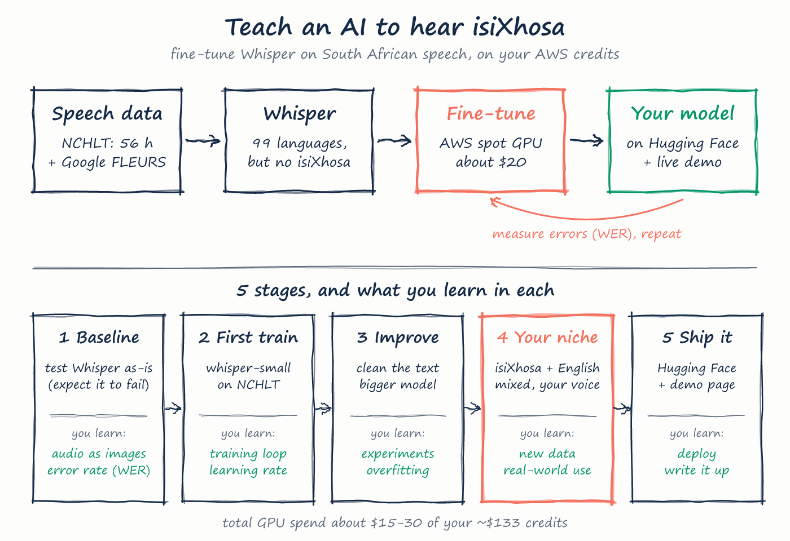

# isiXhosa Speech AI

Fine-tuning OpenAI Whisper to transcribe **isiXhosa**, a language stock Whisper does not support, and then testing it on
isiXhosa with English mixed in (code-switching). It is a learning project by Ntlakanipho Mgaguli (Computer Engineering,
CPUT). Everything ran on one rented cloud GPU at a time, for about **$10 in total**.

> **Status: paused (19 October 2026, [D-0018](decisions.md)).** Stages 1–3 are done, and the best model is R-0012.
> Stage 4 (mixed isiXhosa + English) was measured and its training prepared, but never run. Stage 5 (publishing) did not
> happen.



## Results

Lower is better. **CER** is the share of letters wrong. **WER** is the share of words wrong. isiXhosa words are long, so
one wrong letter fails a whole word, and CER is the fairer headline. Every number links to a run folder with its
command, config, logs and sample outputs.

| Model | NCHLT test (read speech) CER / WER | FLEURS test (unseen sentences) CER / WER | Soapies test (isiXhosa + English, TV) CER / WER |
|---|---|---|---|
| Stock whisper-small ([R-0001](runs/R-0001)) | 75.1 / 196.6 | – | – |
| Stock whisper-medium, `<\|sw\|>` tag ([R-0011](runs/R-0011)) | 33.7 / 137.2 | 45.9 / 142.3 | – |
| whisper-small on NCHLT ([R-0004](runs/R-0004)) | 2.98 / 16.6 | 29.8 / 94.9 | – |
| whisper-small on NCHLT + FLEURS ([R-0007](runs/R-0007)) | 2.91 / 16.8 | 10.2 / 44.4 | 42.1 / 88.0 |
| **whisper-medium on NCHLT + FLEURS ([R-0012](runs/R-0012))** | **2.33 / 12.7** | **8.03 / 37.8** | **38.4 / 79.6** |

Every run is in [results.md](results.md), including the failed ones.

**How to read this honestly:**
- **NCHLT flatters the model.** 82 % of NCHLT test clips repeat a sentence that also appears in training. On test
  sentences it never saw, R-0012 gets CER 5.0 / WER 28.7.
- **FLEURS is the fairer score for read isiXhosa.** Every test sentence there is new to the model. CER 8 % still means
  roughly one word in three has a slip.
- **Mixed, conversational speech is far harder.** On real code-switched soap-opera dialogue
  ([R-0014](runs/R-0014)), R-0012 writes English words with isiXhosa spelling ("stubborn" became "istabhunga"). It gets
  only 32 % of the English words and 15 % of the isiXhosa words right.
- **The model tags isiXhosa as Swahili.** It borrows Whisper's `<|sw|>` token for isiXhosa ([D-0007](decisions.md)).

## What was learned

- **Stage 1:** stock Whisper cannot do isiXhosa. It guessed 52 different languages, mostly Swahili, and wrote 30 % of
  its output in non-Latin scripts.
- **Stage 2:** one fine-tune on about 51 h of NCHLT read speech took CER from 46 % to 3 % (about $1.85). But it learned
  NCHLT's short prompts so well that it glued words together on longer sentences.
- **Stage 3:** adding FLEURS (13 h of varied full sentences) fixed the word-gluing (FLEURS CER 30 % to 10 %). Moving
  from small to medium gave a further gain on every test set.
- **Laptop serving:** an 8-bit CTranslate2 copy of R-0012 runs on a laptop CPU with the same accuracy as the GPU
  ([R-0013](runs/R-0013)). Shortening Whisper's 30-second input window to save time broke it ([P-0012](problems.md)).
- **Process:** 14 problems were logged with cause, fix and lesson in [problems.md](problems.md). Every real choice is in
  [decisions.md](decisions.md).

## How it works

- **Data** is downloaded in the cloud straight into a private S3 bucket by a small self-terminating machine
  (`cloud/fetch_data.sh`). It never touches the laptop and is never committed.
- **Each experiment** is a folder `runs/R-xxxx/` with a `job.sh`. `cloud/run_job.sh` ships the exact git commit to one
  GPU machine. The machine installs pinned packages, runs the job, uploads results to S3 and shuts itself down under a
  hard time cap. `cloud/wait.sh` follows it, and `cloud/collect.sh` copies the results back into the run folder.
- **Training** (`src/train.py`) uses Hugging Face `Seq2SeqTrainer`. It holds out whole speakers for a dev set, keeps the
  checkpoint with the lowest dev CER, and resumes if the machine restarts.
- **Scoring** (`src/scoring.py`) uses one light normalisation shared by every run: lowercase, punctuation removed,
  spelling untouched. Results stay comparable across runs because of it.

| Folder | What's in it |
|---|---|
| `src/` | Data loaders (NCHLT, FLEURS, Soapies), training, evaluation, scoring, the Thetha live page |
| `cloud/` | Launch, follow and collect cloud jobs; the dataset downloader; machine boot scripts |
| `runs/` | One folder per experiment: command, config, logs, metrics, sample outputs, loss curves |
| `docs/` | Hand-drawn explainer sheets (and the scripts that draw them), progress page. The original plan is `SPEC.html` |
| `evidence/` | Results pages for each stage, written for a non-technical reader |
| `JOURNAL.md`, `results.md`, `problems.md`, `decisions.md` | The project's record, append-only |
| `AGENTS.md` | Working rules for the coding agents that built this |

## Running it

**Thetha (talk to the model on a laptop).** This needs Python 3.12 and ffmpeg. The models are not in this repo: copy the
int8 model folders from S3 `models/` into `data/models/` (for example `data/models/R-0012-int8`).

```powershell
python -m venv .venv
.venv\Scripts\pip install torch==2.5.1 --index-url https://download.pytorch.org/whl/cpu
.venv\Scripts\pip install transformers==4.46.3 ctranslate2==4.5.0 soundfile jiwer scipy
$env:CT2_USE_MKL="0"; .venv\Scripts\python src\live.py
```

Then open http://127.0.0.1:7860, press record and speak. It listens on this computer only.

**Cloud runs.** These need the AWS CLI logged in, an S3 bucket and an EC2 instance role (the setup is reused from a
sibling project). They use one GPU at a time with a hard `--max-hours` cap, and the machine terminates itself.

```bash
cloud/fetch_data.sh --job fetch-1 --datasets nchlt,fleurs        # once: datasets into S3
cloud/run_job.sh --run R-0012 --type g6e.xlarge --market ondemand --max-hours 6
cloud/wait.sh R-0012 && cloud/collect.sh R-0012
```

## Data and credits

| Dataset | Used for | Licence |
|---|---|---|
| [NCHLT isiXhosa Speech Corpus](https://hdl.handle.net/20.500.12185/279), CSIR Meraka Institute and North-West University, via SADiLaR | training + test, ~56 h | CC BY 3.0 |
| [Google FLEURS](https://huggingface.co/datasets/google/fleurs) `xh_za` | training + test, ~13 h | CC BY 4.0 |
| [NCHLT English Speech Corpus](https://hdl.handle.net/20.500.12185/274), via SADiLaR | prepared for stage 4 training (never run) | CC BY 3.0 |
| [Multilingual code-switched soap opera speech](https://hdl.handle.net/20.500.12185/545), van der Westhuizen & Niesler, Stellenbosch University | **testing only**, never trained on ([D-0016](decisions.md)) | research only |

No audio, corpus files or model weights are stored in this repository. Raw datasets must not be re-hosted.
The Soapies corpus: E. van der Westhuizen and T. Niesler, "A First South African Corpus of Multilingual Code-switched
Soap Opera Speech", LREC 2018.

Built on [OpenAI Whisper](https://github.com/openai/whisper) (via Hugging Face Transformers) and
[CTranslate2](https://github.com/OpenNMT/CTranslate2).

## Limitations

- The training speech is read aloud. Fast conversational speech, background noise and accents outside the corpora
  are weak spots.
- Only 5 speakers are in the code-switched test set, so the stage 4 numbers are rough.
- The model writes no punctuation or capitals, and writes prefix + loanword with a space (`e afrika`, not `e-Afrika`).
- None of the models has been published.

## Licence

The code and project documents are under the [MIT License](LICENSE). This does not cover the datasets or the dataset
transcripts quoted in run outputs (`runs/*/predictions.jsonl`, `samples.md`), which keep their own licences (above).
